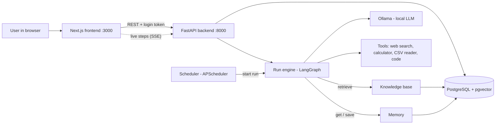

# AgentOS architecture

AgentOS lets a user create an AI agent, give it tools and documents, hand it a task and watch it work.
Risky steps wait for a human to approve them.

## The parts

| Part | Folder | What it does |
| --- | --- | --- |
| Frontend | `frontend/` | Pages for login, agents, runs, knowledge, memory, dashboard and schedule |
| API | `backend/main.py` | One FastAPI app that includes every router below |
| Auth | `backend/auth/` | Register, login, password hashing, login tokens (JWT) |
| Agents, tools, approval | `backend/agents/`, `tools/`, `approval/` | Agent builder, the four tools, ask-first permissions |
| Run engine | `backend/engine/`, `backend/runs/` | The plan, act, observe loop and the live stream |
| Knowledge base (RAG) | `backend/rag/` | Upload, chunk, embed, search |
| Memory | `backend/memory/` | Short-term and long-term memory per agent |
| Metrics | `backend/metrics/` | Numbers for the dashboard |
| Scheduler | `backend/scheduler/` | Starts runs automatically on a schedule |
| Database | `backend/db/` | Table definitions and the database connection |

## How a run works

1. The user (or the scheduler) starts a run for an agent with a task.
2. The engine loads the agent's instructions, its memory (`memory.get`) and the most relevant parts of its documents (`retrieve`).
3. It asks the LLM for a plan, then repeats: choose a tool, check the permission (`auto`, `ask` or `blocked`), run it, read the result. Every step is saved in the `steps` table.
4. A tool set to `ask` pauses the run until the user approves or rejects it.
5. The engine gives a final answer and saves a short memory (`memory.save`).
6. The frontend shows the steps live, and the dashboard reads the `runs` and `steps` tables.

## Knowledge base (RAG)

1. **Upload:** a PDF, TXT, CSV or MD file (up to 10 MB).
2. **Extract:** the text is read out of the file (`pypdf` for PDFs).
3. **Chunk:** the text is cut into overlapping pieces of about 200 words, so a sentence is not lost at a cut.
4. **Embed:** each piece becomes 384 numbers with the `all-MiniLM-L6-v2` model, which captures its meaning.
5. **Store:** pieces and numbers go in the `embeddings` table (pgvector).
6. **Search:** `retrieve(agent_id, query, k)` turns the question into numbers the same way and returns the `k` closest pieces by cosine distance.

## Memory

Two kinds, stored in the `memories` table: **long-term** (facts and preferences the agent keeps) and
**short-term** (notes about recent runs; only the newest 20 per agent are kept).

## Scheduler

Each row in `schedules` (agent, cron text, task, enabled) becomes one APScheduler job. When it fires it
creates a run exactly like `POST /agents/{id}/runs` does. Schedules are reloaded from the database when
the API starts, so they survive a restart. They only run while the API is running. Times use the
`SCHEDULE_TZ` setting (default `Asia/Kolkata`). Cron text uses weekday names (`mon`, `tue`...) because
APScheduler numbers weekdays differently from classic cron.

## Database tables

| Table | Holds | Key links |
| --- | --- | --- |
| `users` | Accounts (email, name, password hash) | |
| `agents` | Name, instructions, tools, permissions, schedule label | belongs to a user |
| `runs` | One row per task run: task, status, start and end time | belongs to an agent |
| `steps` | Plan, tool and observe steps of a run | belongs to a run |
| `documents` | Uploaded file names | belongs to an agent |
| `embeddings` | Text pieces and their 384-number vectors | belongs to a document |
| `memories` | Short and long-term memory text | belongs to an agent |
| `schedules` | Recurring tasks (cron text, task, enabled, last run) | belongs to an agent; deleted with it |

## Security

- Passwords are stored as bcrypt hashes, never as text.
- Login gives a signed token (JWT) valid for 24 hours; every endpoint except register, login and health needs it.
- Every agent, run, document, memory and schedule is checked against the logged-in user. Someone else's data answers `404`, so its existence is not revealed.
- Uploads are limited to known file types and 10 MB. The code tool runs in a sandbox with time and memory limits.
- Secrets live in `.env`, which is never committed.

## Who built what

| Area | Owner |
| --- | --- |
| Agent builder, tools, approval, run engine, live run monitor | Riya |
| Login and app shell, knowledge base, memory, dashboard, scheduler, Docker, CI, docs | Khushi |
| Database tables and seed data | Shared |
